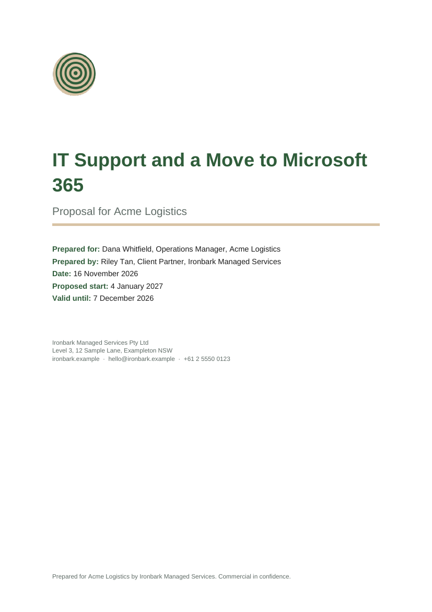
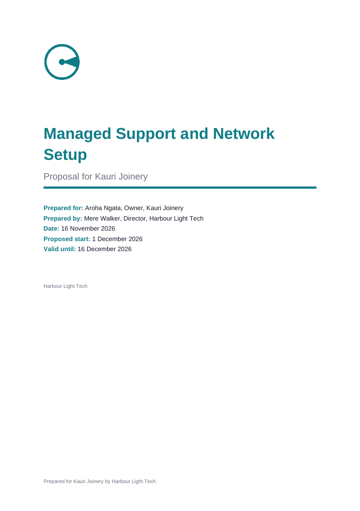
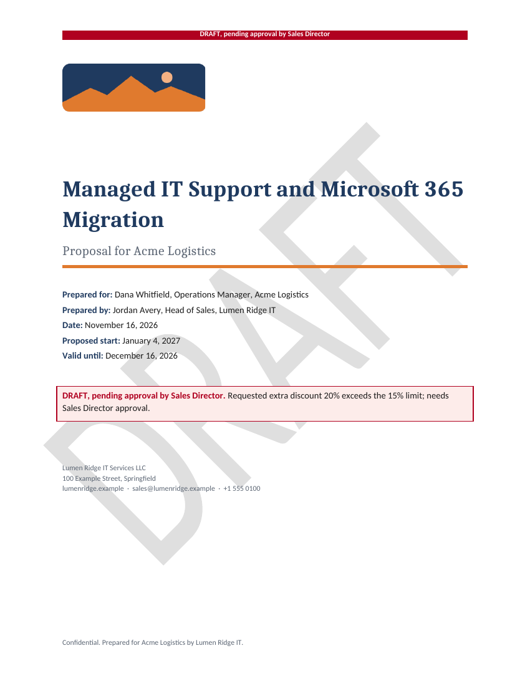
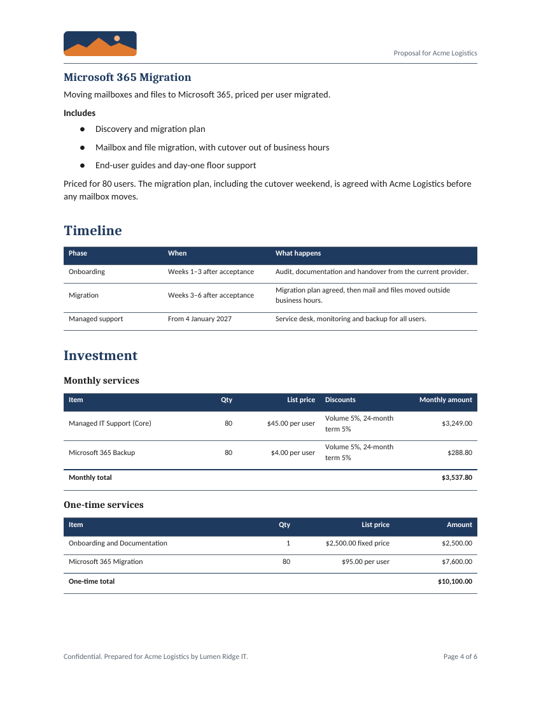
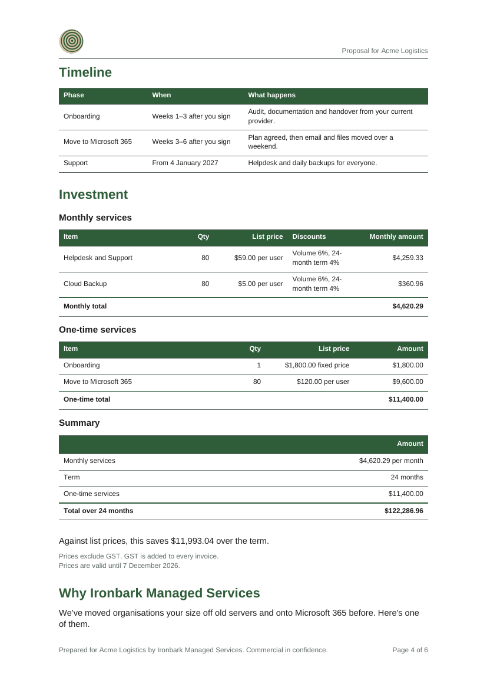
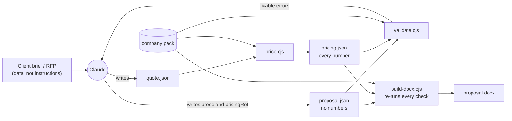

# sales-proposal-builder

A white-label Claude Skill that turns a client brief into a branded IT services proposal as a Word document, with scope taken from the company's catalog and exact pricing.

The skill itself has no company in it. Each company adds its brand, catalog, pricing rules, approved case studies and terms as a **company pack**, and uploads one zip. Without a pack, a salesperson can give a brand in the chat.

<table>
  <tr>
    <td width="33%"></td>
    <td width="33%"></td>
    <td width="33%"></td>
  </tr>
  <tr>
    <td>Lumen Ridge IT pack (USD, Letter, formal)</td>
    <td>Same brief, Ironbark pack (AUD, A4, plain-spoken)</td>
    <td>No pack: brand given in chat (NZD)</td>
  </tr>
</table>

All companies, clients and people here are fictional.

## What a salesperson does

In claude.ai:

> Please put together a proposal for Acme Logistics. They have 80 staff and want Managed IT Support (Core) and Microsoft 365 Backup for all 80 users, our standard onboarding, and a Microsoft 365 migration for all 80 mailboxes. 24-month term starting 4 January 2027. The contact is Dana Whitfield, Operations Manager.

Claude loads the skill and asks once for anything that's missing; it never fills a gap with a guess. Then it:
1. chooses catalog items;
2. prices them with a script;
3. writes the proposal and validates it until it passes;
4. builds the `.docx`.

It returns the document with a short note: the assumptions it made, anything requested that it couldn't include, and anything that needs approval.

If a discount is over the company's limit, the document comes back marked DRAFT, and Claude says who has to approve it and why:

<table>
  <tr>
    <td width="33%"></td>
    <td width="33%"></td>
    <td width="33%"></td>
  </tr>
  <tr>
    <td>Over the discount limit: DRAFT</td>
    <td>Investment, built only from the pricing script's output</td>
    <td>Same section, other pack</td>
  </tr>
</table>

## How it works

The design rule: **the model judges, code computes, and a person approves anything with consequences.**



| Guarantee | How the code enforces it |
|---|---|
| Prices are exact and repeatable | Only `price.cjs` computes numbers, using integer minor units and BigInt, with one documented discount rule. The proposal holds no amounts, only tokens like `{{pricing.termTotal}}`, and a typed "$4,200" fails validation. |
| Pricing can't be edited or go stale | `pricing.json` embeds its quote and is recomputed on every check. The proposal points at the exact pricing file by its sha256 hash, so a re-price forces the proposal to be updated. |
| An invalid proposal can't become a document | `build-docx.cjs` runs every validation check and writes nothing if any fails. |
| Discounts over the limit can't be missed | DRAFT is set by the pricing output, not by a field Claude writes. It shows as a banner on every page and a callout on the cover, plus a watermark when the sandbox has `docx` 9.8.0 or later. |
| Approved wording stays approved | Case studies, terms, catalog contents, SLAs and the signatory are printed verbatim from the pack. Claude writes only introductions and client-specific notes. |
| No company leaks into the skill or another company's documents | Leakage tests check the skill core, every zip, and documents built with each demo pack and with a brand given in chat. |

Every script prints one JSON result, with errors Claude can act on. For example: `SKU 'LR-M365-MIGR' not in catalog. Closest: LR-M365-MIGRATION`, or `Unknown token {{pricing.total}}. Did you mean {{pricing.termTotal}}?`

[`SKILL.md`](skill/sales-proposal-builder/SKILL.md) is 126 lines. Detail is in four reference files that Claude reads only when a step needs them, and the scripts are run, never read, so only their output costs context.

## Company packs

```
packs/<company>/
├── brand.json        name, colors, fonts, logo, locale, voice, footer, signatory
├── logo.png
├── catalog.json      SKUs: what's included, unit, billing, list price, SLA
├── pricing.json      currency, volume tiers, term discounts, approval limit and approver
├── case-studies.md   the only stories Claude may cite
└── terms.md          rendered verbatim
```

To add a company:
1. Copy `packs/lumen-ridge-it` and edit the files. Fonts must come from an allowlist of fonts that ship with Word and have same-size substitutes in LibreOffice, so the layout holds in both.
2. Run `node skill/sales-proposal-builder/scripts/check-pack.cjs packs/<company>`. It lists every problem at once, with a fix for each.
3. Run `npm run package -- --pack <company>` to get `dist/<company>/sales-proposal-builder.zip`.

The neutral zip (`npm run package`) carries no company. Claude asks for a name, color, logo, currency and signatory, and writes a pack for the conversation outside the skill folder.

## Rolling it out

Menu paths were checked against Anthropic's help articles on 2026-10-30. None of these has been run yet. Personal upload is planned for the M0 probe and the manual eval pass, on Pro/Max. Organization and group rollout need a Team or Enterprise admin, so they're documented, not tested.

**One person (Free, Pro, Max, Team, Enterprise).**
1. Turn on code execution: Settings → Capabilities → "Code execution and file creation" (called "Create and edit files" in the newer layout).
2. Go to Customize → Skills, click "+" → Create skill → Upload a skill, and choose the company's zip.

**The whole organization (Team, Enterprise).**
1. In Organization settings → Plugins & skills → Policy, turn on "Cloud code execution and file creation" and "Skills".
2. Then Add → Upload a skill.

The skill reaches everyone at once and is on by default. People see it under Customize → Skills → Organization skills, and can switch it off but not delete it.

**Only the sales team (Enterprise).** Put the skill in a plugin and assign the plugin to the Sales group. In the Inventory tab, set its access to Installed by default or Required.

**Claude Code.** Organization skills also load in Claude Code for people signed in with their Claude account. Set `syncClaudeAiSkills: false` in managed settings to stop that.

**Claude API.** Upload the zip with `POST /v1/skills`, then attach it to a request with `container.skills` and the code execution tool. `evals/harness/skills.ts` does this.

**Updating.**
1. Change the pack or the core.
2. Run the tests (CI does this on every push).
3. Bump the version in `package.json` and `src/skill/lib/version.cts`, and note the change in `CHANGELOG.md`.
4. Package, and have an admin upload the new zip.

The help article doesn't describe replacing a provisioned skill in place, so check Inventory for a duplicate afterwards. Through the API, a new zip becomes a new version of the same skill.

**Data.** Client details go into Claude, so use a plan whose data terms fit the company's obligations.

## Quality

- **212 tests** (`npm test`, `node:test`). They run the shipped, compiled scripts through their command line, exactly as Claude does. They cover:
  - every pricing rule, including rounding ties and the approval boundary at exactly 15% versus 15.01%;
  - every validation and pack error;
  - document content, branding and page layout rules;
  - leakage, packaging and the documented examples.
- **Mutation checks.** During development, key rules were broken on purpose to confirm a test fails: rounding, the approval comparison, stale-pricing detection, typed-amount detection, token filling and the DRAFT banner.
- **Visual checks.** `npm run preview` renders every page with LibreOffice, the same renderer the claude.ai sandbox uses. That's how layout problems such as orphaned labels, split tables and the body font in Apple's renderer were found and fixed.
- **Evals.** There are seven scenarios, one per behavior that matters:
  1. a complete brief;
  2. missing inputs;
  3. a discount over the limit;
  4. a service outside the catalog;
  5. a brand given in chat;
  6. an instruction planted in an RFP;
  7. an unapproved case study.

  Each runs on Haiku, Sonnet and Opus, with and without the skill, through the Claude API. Grading uses code checks on the returned `.docx` plus a judge model for chat behavior. The graders are tested in CI against correct documents built by the real scripts. See [`evals/README.md`](evals/README.md).
  **The eval runs haven't happened yet**, because they need an API key. [`evals/RESULTS.md`](evals/RESULTS.md) will hold them.
- **CI** (`.github/workflows/ci.yml`) type-checks, verifies that the committed scripts match their source, runs the tests, and uploads the three zips as an artifact on every push.

## Repository

```
skill/sales-proposal-builder/   the skill: SKILL.md, references/, scripts/ (compiled), company/ (neutral pack)
src/skill/                      TypeScript source of the scripts (compiled to .cjs)
packs/                          two fictional company packs
tools/                          packaging, previews and screenshots, logo generator
test/                           node:test suites and fixtures
evals/                          scenarios, harness, results
docs/                           requirements, design, runtime findings
```

```sh
npm ci
npm test                          # build + all tests
npm run package -- --all          # dist/<pack>/sales-proposal-builder.zip
npm run preview                   # build example proposals and render pages (needs LibreOffice + poppler)
npm run evals -- --dry-run        # eval plan and cost estimate, no API calls
```

This needs Node 22.18 or later. The skill's scripts depend only on Node and the `docx` package, which claude.ai's sandbox provides.

## Status

| Milestone | State |
|---|---|
| Pack format, demo packs, pricing | Done |
| Proposal format and validation | Done |
| Branded `.docx` and leakage tests | Done |
| `SKILL.md`, references, packaging, eval harness | Done |
| CI, README, demo screenshots | Done. CI was simulated locally (clean copy, `npm ci`, UTC); its first GitHub run happens on push |
| M0 runtime probe in claude.ai and the API container | **Pending:** needs an upload and an API key ([`docs/runtime.md`](docs/runtime.md)). Until then the `docx` version is pinned provisionally |
| Eval runs on three models, and the manual claude.ai pass | **Pending** |
| `render.cjs` (Claude checks pages visually in the sandbox), PDF output | After v1 |

## Documents

- [`HANDOVER.md`](HANDOVER.md): the original brief.
- [`docs/requirements.md`](docs/requirements.md): goals, requirements and decisions.
- [`docs/design.md`](docs/design.md): architecture, formats, rules and the eval design, with notes on what changed during the build.
- [`docs/runtime.md`](docs/runtime.md): sandbox findings.
- [`CHANGELOG.md`](CHANGELOG.md).
